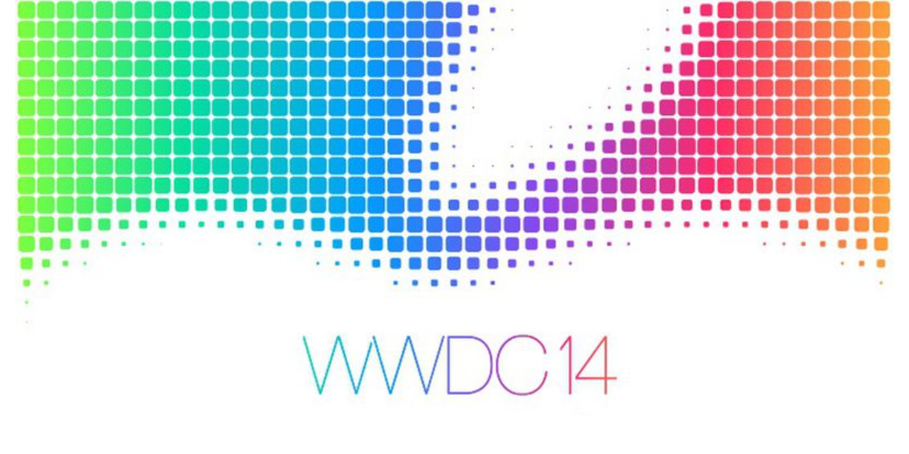

# WWDC 2014 - Scholarship

List of student submissions for the WWDC 2014 - Scholarship. The list is in alphabetical order.

Try out the WWDC apps inside your browser: http://www.wwdcstudents.co

### How to add your submission?
1. **[Click here to open the form](https://github.com/wwdc/2014/issues/new?template=submit.yml)** and fill it in.
2. Send it. A bot checks your entry within a minute and tells you if anything needs fixing. You can edit the form after sending.
3. When it is approved your entry appears on this list.

#### How to update or remove your submission?
Use the **[update form](https://github.com/wwdc/2014/issues/new?template=update.yml)**. Only the person who sent the entry can change it.

### Submissions

| Participant | Links  | Status            |
|:--|:--|:--|
| [Aaron Wojnowski](https://twitter.com/awojnowski) | [GitHub](https://github.com/awojnowski/WWDC2013) |  |
| [Adam Bell](https://twitter.com/b3ll) |  |  |
| [Adrien Truong](http://twitter.com/adrient_) | [GitHub](https://github.com/adrientruong/WWDC2014) |  |
| [Ahmed Fathi](https://twitter.com/iAFapps) | [GitHub](https://github.com/AFathi/WWDC2014) |  |
| [Akhil Tolani](https://www.twitter.com/Saltb0x) | [GitHub](https://github.com/Saltb0xApps/WWDC-2014-Scholarship-Application) |  |
| [Alex Telek](https://twitter.com/@alexmtk) | [Video](https://www.youtube.com/watch?v=B8GLQ-ZnjjQ) |  |
| [Andrew Breckenridge](https://www.twitter.com/Andrew_Breck) |  |  |
| Ashwin Agarwal | [GitHub](https://github.com/aaga/WWDC-2014-Scholarship-Entry) · [Video](https://www.facebook.com/photo.php?v=662160460499436) |  |
| [Austin Valleskey](https://twitter.com/@ajvalleskey) | [Video](https://www.facebook.com/photo.php?v=526092777508950) |  |
| [Ben Pasternak](http://twitter.com/@BenPasternak) | [Video](https://www.youtube.com/watch?v=uuAS4n3zozs&feature=youtu.be) |  |
| Benedikt Hirmer | [GitHub](https://github.com/bhr/WWDC2014-Scholarship-Application) · [Video](https://www.youtube.com/watch?v=p0MilL8QPUk) |  |
| [Braeden Mayer](https://twitter.com/@Braeden_Mayer) | [GitHub](https://github.com/Braeden-Mayer/Braeden-Mayer) |  |
| [Brian Chan](http://twitter.com/b123400) | [GitHub](https://github.com/b123400/wwdc2014) · [Video](https://www.youtube.com/watch?v=CTET-LYe3vY) |  |
| Brian Jett | [GitHub](https://github.com/bdjett/WWDC-2014) |  |
| Canzhi Ye |  |  |
| [Chris Galzerano](https://twitter.com/@chrisgalz) | [Video](https://www.youtube.com/watch?v=XImIArqS3ww&feature=youtu.be) |  |
| [Clemens Schulz](https://twitter.com/@cl1993) | [Video](https://www.youtube.com/watch?v=mn4ZPR9sNnA) |  |
| Cole Dunsby | [GitHub](https://github.com/Coledunsby/WWDC14) |  |
| [Conrad Kramer](https://twitter.com/@conradev) | [GitHub](https://github.com/conradev/WWDC2014) · [Video](https://www.youtube.com/watch?v=hzAjT7hbJSM) |  |
| [Coulton Vento](http://twitter.com/@coultonvento) | [GitHub](https://github.com/coultonvento/WWDC-2014) |  |
| [Daniel Van Der Merwe](https://twitter.com/@danieljvdm) | [GitHub](https://github.com/danieljvdm/Daniel-van-der-Merwe) |  |
| [David Roman](https://www.twitter.com/@Dromaguirre) | [GitHub](https://github.com/Dromaguirre/WWDC-2014-Scholarship-App) |  |
| [Douglas Bumby](http://www.twitter.com/istx25) | [GitHub](https://github.com/istx25/WWDC-2014-Submissions) · [Video](https://www.dropbox.com/s/2cwuvmfjkmm7git/ios-wwdc-app.mov) |  |
| Douglas Ferreira | [Video](https://www.youtube.com/watch?v=eXRwoUBnGXo) |  |
| [Eytan Schulman](https://twitter.com/zorcan1) |  |  |
| [Farzad Nazifi](https://twitter.com/euwars) | [Video](http://youtu.be/gmgbqeiYvFU) |  |
| [Finn Gaida](https://twitter.com/@FinnGaida) | [GitHub](https://github.com/finngaida/wwdc/tree/master/2014) · [Video](http://www.youtube.com/watch?v=OKKF6o9wduI) |  |
| [Frederik Riedel](http://twitter.com/@FrederikRiedel) | [Video](http://youtu.be/8oy6gPt551Q) |  |
| [iPhonig](https://twitter.com/iphonig) | [GitHub](https://github.com/iPhonig/WWDC-2014-Student-Scholarship-App) |  |
| [Isaac Rodríguez](https://twitter.com/@sideround) | [Video](https://www.youtube.com/watch?v=LQFMa-yRrlk) |  |
| [Isaiah Turner](https://twitter.com/@IsaiahJTurner) | [GitHub](https://github.com/IsaiahJTurner/IsaiahJTurner) · [Video](https://www.facebook.com/photo.php?v=712518992128745) |  |
| [Jak Tiano](http://twitter.com/@ChasElt) | [GitHub](https://github.com/Jakintosh/WWDC-2014-Application) · [Video](https://www.youtube.com/watch?v=6_zIcACwhuk) |  |
| [Jaxon Stevens](https://twitter.com/RouteTravel66) |  |  |
| [Jeroen van Rijn](http://twitter.com/@Jeroen0704) | [Video](https://www.youtube.com/watch?v=xUt5UCBAoLI) |  |
| [Jonah Grant](https://twitter.com/@jonahgrant) | [GitHub](https://github.com/jonahgrant/wwdc) · [Video](https://www.facebook.com/photo.php?v=10203790746388689) |  |
| Justin Loew | [GitHub](https://github.com/jloloew/BrailleLearner) |  |
| [Khaos Tian](https://twitter.com/KhaosT) | [GitHub](https://github.com/KhaosT/WWDC-14-Scholarship-Entry) |  |
| [Kolin Krewinkel](https://twitter.com/@kkrewink) | [GitHub](https://github.com/kolinkrewinkel/WWDC14) |  |
| [Kyle Ryan](http://twitter.com/@kylry) | [GitHub](https://github.com/kylry/kyleryan) · [Video](https://www.facebook.com/photo.php?v=10152013038854149) |  |
| [Kyle Spadaro](https://twitter.com/kylespadaro) |  |  |
| [Lars Schwegmann](https://twitter.com/larsschwegmann) | [GitHub](https://github.com/larsschwegmann/WWDC-14) · [Video](https://www.facebook.com/photo.php?v=637685916301320) |  |
| Lea Marolt Sonnenschein | [GitHub](https://github.com/leamars/LeaMaroltSonnenschein) |  |
| [Leonard Pauli](https://twitter.com/LeonardPauli) | [Video](https://www.youtube.com/watch?v=kvRqZf4E2mU) |  |
| [Louis Harboe](http://twitter.com/@spiralstairs) |  |  |
| [Lukáš Petr](https://twitter.com/luksape) | [Video](http://www.youtube.com/watch?feature=player_embedded&v=kDQ-nnGX9RA) |  |
| [Lukas Spieß](https://twitter.com/Blubser) | [Video](https://vimeo.com/94400719) |  |
| [Madhav Narayan](https://www.facebook.com/soccermadhav) |  |  |
| [Maijid Moujaled](https://twitter.com/@DrJid) | [GitHub](https://github.com/DrJid/Personal-Portfolio-app) |  |
| [Marc Cuva](https://twitter.com/marccuva) | [GitHub](https://github.com/mjcuva/WWDC2014) |  |
| Matis De Schutter | [Video](http://www.youtube.com/watch?v=N_YwxvRMpRE) |  |
| [Matt Zanchelli](https://www.twitter.com/@mdznr) | [GitHub](https://github.com/mdznr/WWDC-2014-Scholarship-Application) |  |
| [Mayank Jain](https://www.twitter.com/mjmayank1) | [GitHub](https://github.com/mjmayank/WWDC) |  |
| [Mert Dümenci](http://twitter.com/mertdumenci) | [Video](http://www.youtube.com/watch?v=z_se6loQj-w) |  |
| [Michal Smialko](https://twitter.com/@msmialko) | [GitHub](https://github.com/Moriquendi/WWDC2014) · [Video](https://twitter.com/msmialko/status/455832748247506944) |  |
| [Moshe Berman](https://twitter.com/@bermaniastudios) | [GitHub](http://github.com/mosheberman/MosheBerman-iOS) |  |
| [Nate Chiger](http://twitter.com/natechiger) | [GitHub](https://github.com/natechiger/WWDC-2014-Scholarship) |  |
| [Neeraj Baid](https://twitter.com/2neeraj) | [GitHub](https://github.com/neerajbaid/WWDC2014) |  |
| Nicholas Gibson | [Video](https://www.youtube.com/watch?v=-KaUURIz9TA) |  |
| [Nick Frey](http://twitter.com/NickFrey) |  |  |
| [Nicola Giancecchi](http://twitter.com/nicorsm) | [Video](http://youtu.be/V3D9OzG3wAQ) |  |
| [Patrick Balestra](http://twitter.com/@BalestraPatrick) | [GitHub](https://github.com/BalestraPatrick/WWDC-2014-Scholarship) · [Video](http://youtu.be/1nrBQDeDeQg) |  |
| [Radek Pietruszewski](https://twitter.com/radexp) | [Video](https://www.youtube.com/watch?v=ouumNZu1RAA) |  |
| [Rameez Remsudeen](http://twitter.com/remzr7) |  |  |
| [Rohan Kapur](http://twitter.com/@MCKapur) | [GitHub](https://github.com/MCKapur/WWDC-2014-Scholarship-App) |  |
| [Sam Turner](http://www.twitter.com/rheotron) | [GitHub](https://github.com/samturner/wwdc-scholarship-2014) · [Video](https://www.youtube.com/watch?v=lu_0gVWN8hA&feature=youtu.be) |  |
| [Sanjeet Suhag](https://twitter.com/@sanjeetsuhag) | [GitHub](https://github.com/sanjeetsuhag/WWDC-2014-Scholarship-App) |  |
| [Sjors Snoeren](http://twitter.com/@sjorssnoeren) | [GitHub](https://github.com/SjorsSnoeren/WWDC-App-2014) |  |
| [Tosin Afolabi](http://twitter.com/@tosinaf) | [GitHub](https://github.com/TosinAF/WWDC-2014) · [Video](http://youtu.be/OVu5M5hHTB8) |  |
| [Tyler Flowers](https://twitter.com/tdflowers) | [GitHub](https://github.com/Tdflowers/WWDC2014) |  |
| [Veeral Patel](http://twitter.com/vral) |  |  |
| [Victor Ilisei](https://twitter.com/@GeekyLemon) | [GitHub](https://github.com/TechGeniusApps/WWDC-App) |  |
| [Vijay Sridhar](https://twitter.com/sridvijay) | [Video](https://www.youtube.com/watch?v=VKcvYUD1pio) |  |
| [Yichen Cao](http://twitter.com/schemetrical) |  |  |

##### Total: 73 | Awarded: 27
